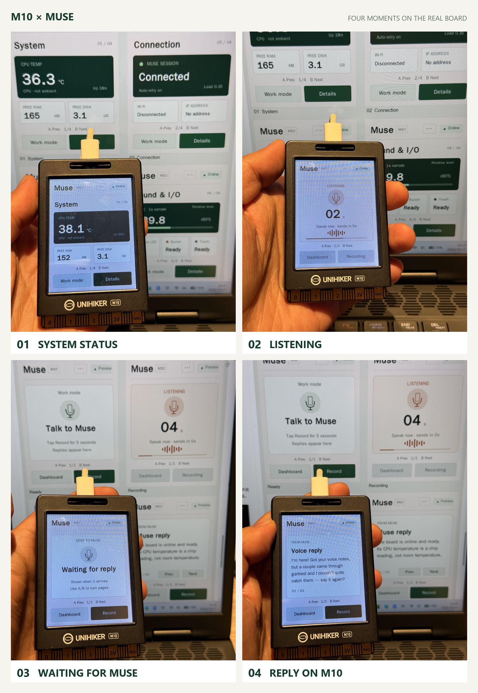
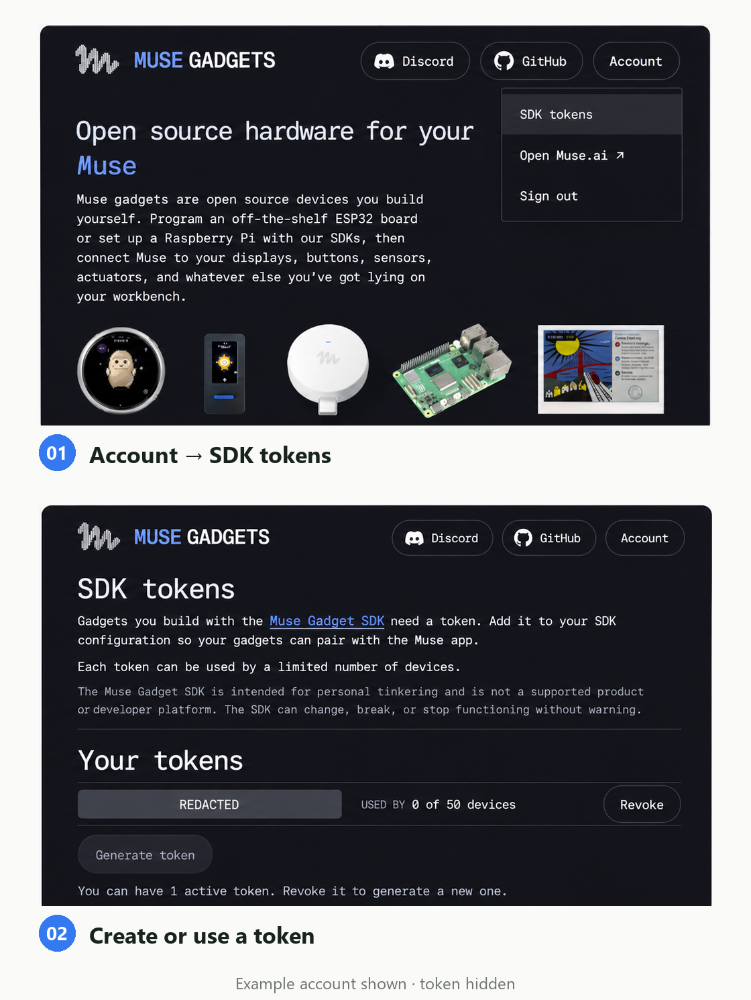
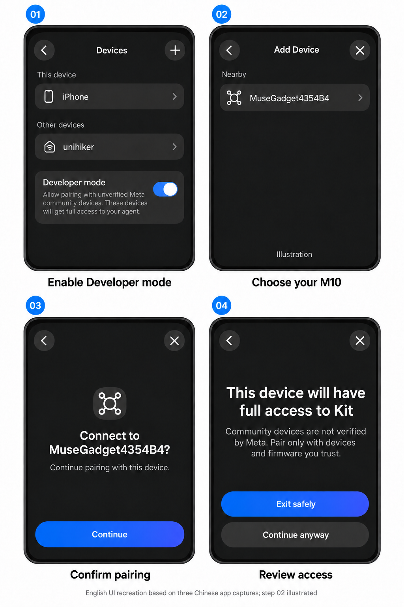
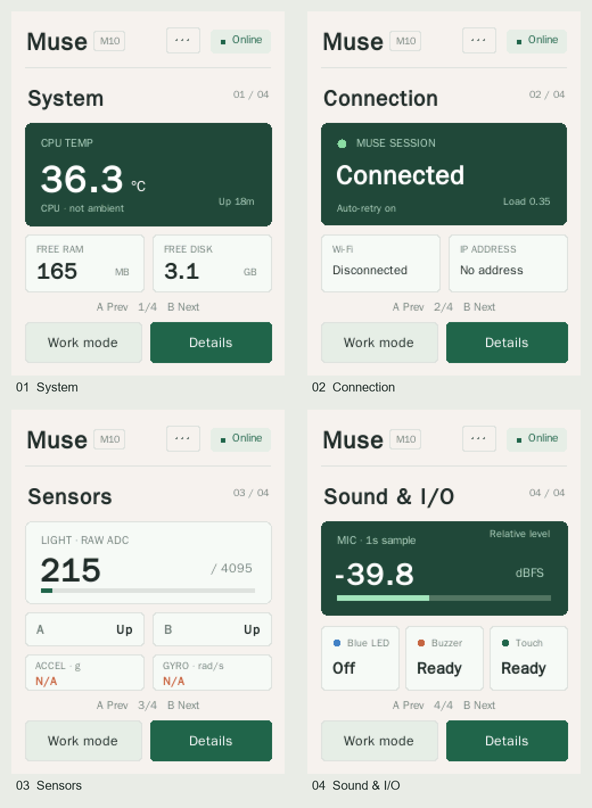
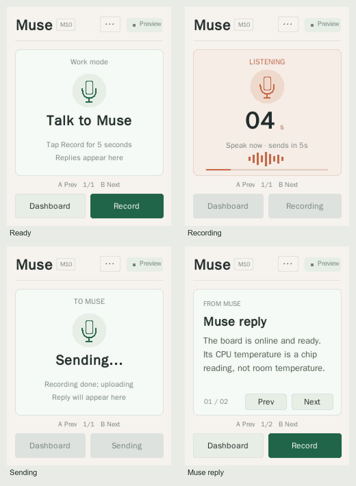
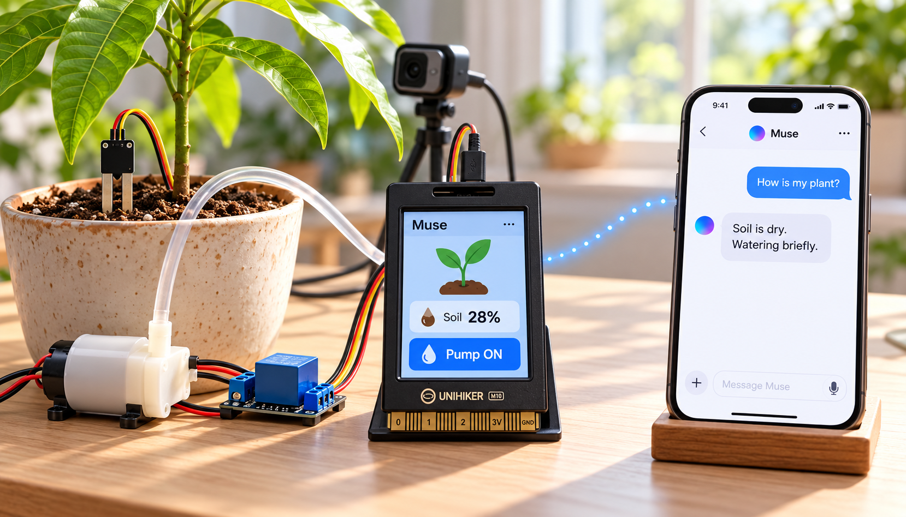

# Make Your UNIHIKER M10 Talk to Muse: Live Data, Voice Notes, and On-Screen Replies

Cover the M10's light sensor with your finger and watch the number on its screen change. Then ask Muse on your phone, “How is my M10 doing?” Muse can call a tool on the board and report live figures such as available memory, free disk space, and chip temperature. With the setup in this guide, the board can collect data, Muse can respond to it, and Muse's reply can appear back on the M10 screen.

You can build this interaction with just one M10. First, pair it using Muse's official Linux SDK. Then add a dashboard and a work mode: flip through live status pages, tap the screen to record a voice note, and read Muse's reply on the board. The screen, buttons, light sensor, and microphone are already built in; no extra sensors are needed for the main project.

Four moments from the working build: dashboard, recording, waiting, and Muse's reply on the M10. Click the image to see the screen details.

Muse already has [instructions for connecting a Raspberry Pi or another Linux device](https://github.com/facebookincubator/muse-gadget-sdk/blob/main/linux/README.md). The M10 puts a touchscreen, buttons, a microphone, and sensors together in one handheld board. Once connected, you can check its status and read replies on the board itself. The interface shown here is a separate program written for the M10; installing the SDK alone will not add these screens.

## Step 1: Pair the M10 with Muse

If your M10 is already running Debian 12, you can start here. You'll need a USB data cable, an M10 with internet access, the Muse app on your phone, and an SDK token. To get a token, sign in to [Muse Gadgets](https://gadgets.muse.ai/), then open **Account → SDK tokens**. If you don't have a token yet, choose **Generate token** under **Your tokens**.

The account in the illustration already has a token, so **Generate token** is disabled. At the time of writing, the page allows one active token per account. The token identifier in the image has been hidden. If you generate a new token, save it as the site instructs; don't revoke a working token just to make your screen match the illustration.

Connect the M10 to your computer with the USB data cable. Confirm that you're working on the intended board and that it has internet access and working Bluetooth. Then follow the [official Linux SDK installation guide](https://github.com/facebookincubator/muse-gadget-sdk/blob/main/linux/README.md). Installation requires an account on the board that can run `sudo`. The SDK token is a pairing credential: enter it privately in the board's terminal, not in an AI chat, screenshot, or public repository.

After installation, the board opens a pairing window. In the Muse app, go to **Settings → Devices**, enable **Developer mode**, tap **Add Device**, and select the device whose name begins with `MuseGadget`. Check the name and read the permissions notice before continuing. The suffix is different for each board, so yours will not necessarily match the picture.

The panels follow the pairing sequence. Panels 1, 3, and 4 were redrawn in English from screenshots of the Chinese app. Panel 2, “Select device,” was drawn from the [official Linux SDK pairing instructions](https://github.com/facebookincubator/muse-gadget-sdk/blob/main/linux/README.md#set-it-up-with-muse); **it is not an actual app screenshot**. Labels and placement may change as the app evolves.

Once the app says the M10 is connected, test a real tool call. Ask Muse on your phone to **call `device.health` on this M10**: “How long has it been running, and how much memory and disk space are free?” On the board, check `musegadget info` and `systemctl status musegadget` as well. Live figures in the app, together with a corresponding call on the board, verify the connection. If Muse merely says “connected” without calling the tool, check pairing and tool availability again.

One detail matters: the temperature from `device.health` is the **chip temperature**, not the room temperature. Don't present it as an ambient reading.

## Step 2: Give the board its own interface

Now that Muse can ask the board for its status, let the M10 show that information too. The interface has two modes. **Dashboard** has pages for system health, connectivity, onboard sensing, sound, and output devices. In **Work Mode**, tap the screen to start recording, watch the upload status, and read the text Muse sends back. Use the touchscreen to switch modes and the A/B buttons to turn pages.

These four dashboard pages come from a running M10. In the example, Muse says “Online” while Wi-Fi says “Disconnected” because the board was reaching Muse through another network connection. The two labels describe different connections.

The Work Mode images use preview data to check the English screen layout. They are **not** proof of a complete voice conversation. On your own board, verify “recording sent” and “reply shown on screen” separately: a successful upload does not guarantee that the reply arrived.

Running this interface also requires the M10's display, button, and hardware services, plus code to record audio, send messages, and display replies. See the [English interface source and deployment notes](https://github.com/daxiaguanghua-dev/unihiker-m10-muse/blob/main/m10-ui-english/README.md), but bear in mind that the current source is not a one-click installer for every new board. Before deploying, have your AI coding tool back up the existing files, inspect the services already installed, and integrate the pieces one at a time. If an SDK extension or hardware service is missing, implement and verify it first. A preview image helps check the design; it cannot replace a test on the board.

## Step 3: Try two quick experiments

First, find the light reading in Dashboard. Cover the sensor, then uncover it. The number should change with the light. It is a raw reading, **not a lux measurement**. If a sensor cannot be read, show N/A rather than inventing a plausible value.

Next, switch to Work Mode, tap Record, and say something to the board. You should see the recording and sending states on the M10. If Muse returns text, the board should display it. If one stage fails, start troubleshooting there. Being able to chat with Muse on your phone does not, by itself, prove that the board received a reply.

If you use Codex or another AI coding tool to help with deployment, give it this guide and the [official SDK documentation](https://github.com/facebookincubator/muse-gadget-sdk/blob/main/linux/README.md), along with this prompt:

> I have a UNIHIKER M10 running Debian 12. First confirm that you're connected to this board. Check its network, Bluetooth, existing files, and services. Back up what is already there, then install and pair the official Linux SDK according to its documentation. Let me enter the SDK token privately in the board's terminal. Verify the connection with a real `device.health` call from the Muse app before deploying the Dashboard and Work Mode from this guide's interface source. At each step, tell me what I should see in the app or on the board. Show N/A for unavailable sensors, and tell me plainly if code or permissions are missing. Finally, check whether the setup recovers after a reboot.

At this point, you can ask about live board status from your phone and send a voice note from the M10 to Muse, then read the reply on the M10. Later, you could add a soil-moisture probe, USB camera, relay, and water pump to help Muse watch over a plant. External hardware can be a project of its own. For now, with just the M10 in your hand, what would you want it to tell Muse?

*Possible next project, shown as a concept illustration. The moisture value and pump state illustrate an interaction; they are not measurements or controls verified in this guide.*

References: [Muse Linux Device SDK](https://github.com/facebookincubator/muse-gadget-sdk/blob/main/linux/README.md) · [Muse Gadgets](https://gadgets.muse.ai/) · [UNIHIKER M10](https://www.unihiker.com/products/m10)
